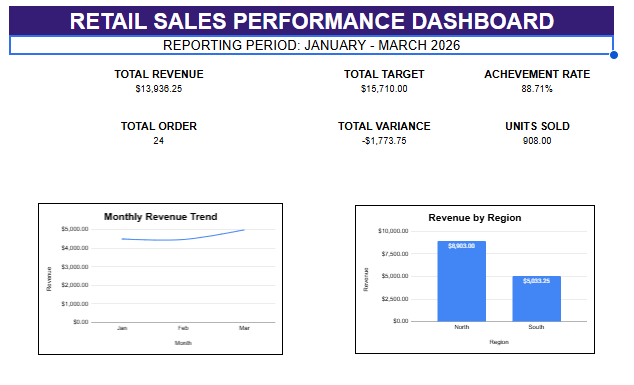

# Retail Sales Performance Dashboard

## Project Overview
An interactive retail sales analysis project built using Google Sheets. The project focuses on analyzing sales performance, comparing revenue against targets, and identifying business insights from a sample retail dataset.

## Tools Used
- Google Sheets
- Pivot Tables
- Spreadsheet formulas
- Charts and visualizations
- Data cleaning

## Key Features
- Data cleaning and duplicate checks
- Revenue and target variance calculations
- Six KPI metrics
- Four PivotTables for monthly, regional, product, and category analysis
- Four dashboard visualizations
- Business insights based on sales performance

## Dashboard KPIs

| Metric | Result |
|---|---:|
| Total Revenue | $13,936.25 |
| Total Target | $15,710.00 |
| Achievement Rate | 88.71% |
| Total Orders | 24 |
| Target Variance | -$1,773.75 |
| Units Sold | 908 |

## Key Business Insights
1. March recorded the highest monthly revenue.
2. North generated the highest regional revenue.
3. Notebook was the lowest-revenue product.
4. Electronics contributed the highest category revenue.
5. Total revenue did not meet the overall sales target.

## Dashboard Preview

## Project Structure
- `Retail_Sales_Analysis.xlsx` — Analysis workbook
- `dashboard_overview.png` — Dashboard screenshot
- `README.md` — Project documentation

## What I Learned
- Cleaning and organizing structured sales data.
- Using spreadsheet formulas to calculate business metrics.
- Creating PivotTables for business analysis.
- Building a KPI-based sales dashboard.
- Translating numerical results into business insights.

## Data Note
This project uses a small sample retail dataset for educational and portfolio purposes.
